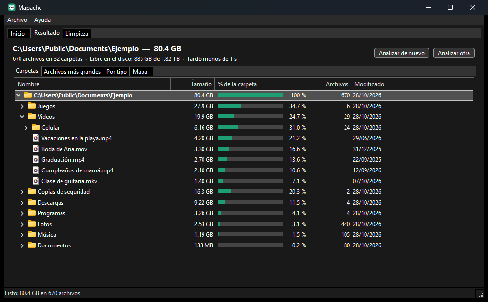

# Mapache

**Mira qué ocupa tu disco y limpia lo que sobra.** Gratis, sin publicidad y sin recoger tus datos.



## Qué hace

- Muestra tus unidades (C:, D:...) con cuánto espacio tienen usado y libre.
- Analiza una unidad o una carpeta, rápido y sin congelar la ventana. Puedes cancelar cuando quieras.
- Te enseña lo que encontró de cuatro maneras:
  - **Carpetas**: un árbol de mayor a menor, con lo que ocupa cada cosa dentro de su carpeta.
  - **Archivos más grandes**: los 200 archivos que más ocupan.
  - **Por tipo**: cuánto ocupan los videos, las imágenes, la música, los documentos, los programas y los comprimidos.
  - **Mapa**: un rectángulo por archivo, más grande cuanto más ocupa, con un color por tipo.
- Con clic derecho sobre una carpeta o un archivo: **Abrir**, **Mostrar en el Explorador**, **Copiar ruta** y **Enviar a la Papelera**.
- **Limpieza segura**: la Papelera, los archivos temporales viejos, los informes de errores de Windows y las cachés de los juegos.

## Cómo se usa

1. Baja `Mapache-0.1.2-x64.zip` de la [página de descargas](https://github.com/Brizna-Soft/mapache/releases/latest).
2. Descomprímelo y abre `Mapache.exe`. No hace falta instalar nada.
3. Elige una unidad y pulsa **Analizar** (o pulsa **Elegir carpeta...**).
4. Mira qué ocupa más. Si algo ya no te sirve, haz clic derecho y elige **Enviar a la Papelera**.
5. El espacio se libera de verdad cuando vacías la Papelera (en la pestaña **Limpieza**).

Si Windows muestra «Windows protegió su PC», pulsa **Más información** y después **Ejecutar de todas formas**.
Pasa porque el programa todavía no está firmado.

Funciona en Windows 10 y Windows 11 de 64 bits. Se ve oscuro o claro, igual que tu Windows.

## Qué borra y qué no

**Enviar a la Papelera**

- Siempre va a la Papelera de reciclaje: puedes recuperarlo desde ahí. Antes te pregunta y te dice cuánto ocupa.
- Nunca borra para siempre. Si Windows lo fuera a borrar para siempre (por ejemplo, porque no cabe en la Papelera),
  Mapache lo cancela y no se borra nada.
- No deja enviar a la Papelera:
  - la raíz de una unidad (por ejemplo, `C:\`);
  - las carpetas de Windows, de los programas instalados (`Program Files`) y `ProgramData`, ni nada de adentro;
  - tu carpeta personal entera, la carpeta de usuarios, ni carpetas especiales enteras (Documentos, Escritorio,
    Descargas, AppData y otras), aunque sí lo que tienen dentro;
  - lo que es de otras cuentas de la PC;
  - lo que está en unidades sin Papelera, como memorias USB o unidades de red.

**Limpieza**

Solo borra cosas que Windows y los programas vuelven a crear cuando hacen falta:

| Qué | Dónde | Detalle |
|---|---|---|
| Papelera de reciclaje | Todas las unidades | Viene sin marcar. Al vaciarla ya no se puede recuperar. |
| Archivos temporales | `%TEMP%` | Solo los que tienen más de 24 horas y que ningún programa está usando. Solo si tu carpeta temporal está dentro de `%LOCALAPPDATA%\Temp`, en un disco de esta PC; si no, Mapache no la toca. |
| Informes de errores de Windows | `%LOCALAPPDATA%\Microsoft\Windows\WER` | Los informes que Windows guarda cuando un programa se cierra solo. |
| Cachés de sombreadores (juegos) | `%LOCALAPPDATA%\D3DSCache`, `NVIDIA\DXCache`, `AMD\DxCache`, `AMD\DxcCache` | Se vuelven a crear; la primera vez que abras un juego puede tardar un poco más. |

- Antes de limpiar te dice cuánto se libera y te pregunta.
- Los temporales, los informes y las cachés se borran del todo (no van a la Papelera), porque se vuelven a crear.
- Nunca sigue accesos directos de carpetas (uniones o enlaces) ni toca archivos que están solo en la nube.
- Abre cada carpeta y cada archivo sin seguir enlaces y, antes de borrarlo, comprueba que de verdad está dentro de
  la carpeta que se limpia. Si algo cambió de lugar en medio, se lo salta.
- No toca el registro, no cambia la configuración de Windows y nada pide permiso de administrador.
- Para limpiar más (por ejemplo `Windows.old` o restos de actualizaciones) tiene botones que abren el
  **Liberador de espacio** y el **Sensor de almacenamiento** de Windows.

## Privacidad

- Mapache no se conecta a internet. Solo lo hace si pulsas **Ayuda > Buscar actualización**: entonces consulta
  la página de versiones de este repositorio en GitHub.
- Sin publicidad, sin telemetría y sin recoger datos.
- Solo guarda el tamaño y el lugar de la ventana en `%LOCALAPPDATA%\Mapache\ajustes.json`.

## Lo que todavía no hace (versión 0.1.2)

- Los archivos con varios «enlaces duros» (hay muchos dentro de `C:\Windows`) se cuentan cada vez que aparecen,
  así que Windows puede parecer más grande de lo que es.
- Muestra el tamaño de los archivos, no el espacio exacto que usan en el disco (los archivos comprimidos o
  «dispersos» pueden ocupar menos).
- Las carpetas en las que Windows no da permiso no se pueden revisar: se marcan «sin permiso».
- Los archivos de OneDrive que están solo en la nube cuentan 0, porque no ocupan espacio en el disco.

## Reportar un problema

En Mapache: **Ayuda > Reportar un problema**, o directamente aquí:
[reportar un problema o proponer una idea](https://github.com/Brizna-Soft/mapache/issues/new/choose).

## Compilar

Hace falta Visual Studio 2022 (o sus Build Tools) con C++, y Git.

```
powershell -ExecutionPolicy Bypass -File compilar.ps1
powershell -ExecutionPolicy Bypass -File empaquetar.ps1
```

El programa queda en `programa\Mapache.exe` y el paquete en `publicar\`. La primera vez, vcpkg compila
wxWidgets y tarda unos minutos.

## Licencia

MIT. Copyright (c) 2026 Brizna Soft. Usa [wxWidgets](https://www.wxwidgets.org) y
[nlohmann/json](https://github.com/nlohmann/json); sus licencias están en `AVISOS-DE-TERCEROS.txt`.

Hecho por Brizna Soft, con ayuda de IA. Si te sirve, puedes [donar](https://paypal.me/BriznaSoft).
Más programas gratis en [brizna-soft.github.io](https://brizna-soft.github.io).
